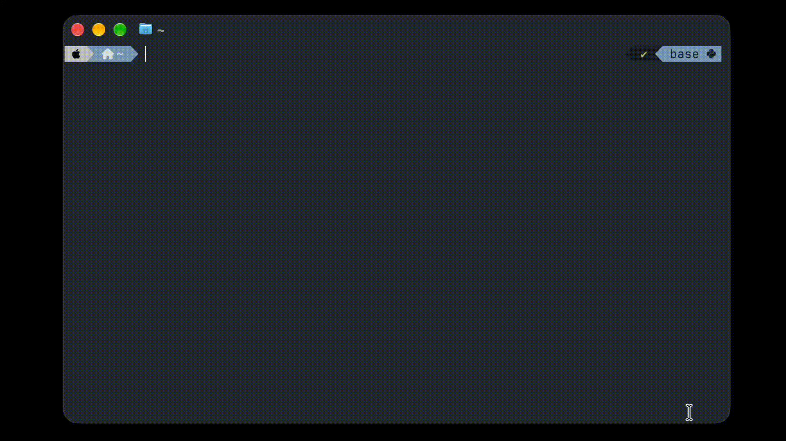

<p align="center">
  <picture>
    
  </picture>
</p>

<h1 align="center">DeckSempai</h1>

<p align="center">
    Assistant to the regional flashcard deck manager
</p>

<p align="center">
  <a href="#features">Features</a>&nbsp;&nbsp;&nbsp;
  <a href="#installation">Installation</a>&nbsp;&nbsp;&nbsp;
  <a href="#get-started">Get Started</a>&nbsp;&nbsp;&nbsp;
  <a href="#future-features">Future Features</a>&nbsp;&nbsp;&nbsp;
  <a href="#license">License</a>
</p>

## Features
* Import/export cards from/to Anki
* Automatically translate
* Automatically add pronunciation sounds
* Automatically add grammar help (articles, plurals, tenses, superlatives etc.)

<p align="center">
  <picture>
    
  </picture>
</p>

## Installation

DeckSempai is installed with [uv](https://docs.astral.sh/uv/), a Python package and project manager.

### 1. Install uv

macOS / Linux:

```bash
curl -LsSf https://astral.sh/uv/install.sh | sh
```

Windows (PowerShell):

```powershell
powershell -ExecutionPolicy ByPass -c "irm https://astral.sh/uv/install.ps1 | iex"
```

Or with Homebrew: `brew install uv`. See the [uv installation docs](https://docs.astral.sh/uv/getting-started/installation/) for other options.

### 2. Install DeckSempai

```bash
uv tool install git+https://github.com/lkyzlik/deck-sempai.git
```

Or from a local clone:

```bash
git clone https://github.com/lkyzlik/deck-sempai.git
cd deck-sempai
uv tool install .
```

uv will fetch a suitable Python (>=3.13) automatically if needed. The `sempai` command is then available on your `PATH`:

```bash
sempai --help
```

To upgrade later, run `uv tool upgrade deck-sempai`; to remove it, `uv tool uninstall deck-sempai`.

## Get started

### Integrations

Most features need a connection to another app or service:

| Integration | Used for | Requires |
|---|---|---|
| `anki` | Storing decks and cards | [Anki](https://apps.ankiweb.net) desktop app running, with the [AnkiConnect](https://ankiweb.net/shared/info/2055492159) add-on |
| `ollama` | Translation and AI grammar help | [Ollama](https://ollama.com/download) running locally, with the configured model pulled |
| `ordnet` | Danish pronunciation and grammar lookups | Internet access to [ordnet.dk](https://ordnet.dk) |

Check that the integrations work with:

```bash
sempai status          # all integrations
sempai status anki     # just one
```

Any disconnected integration lists the steps to set it up. Unused integrations can be disabled with `enable = false` in the
config (`sempai config`).

### Usage

Run `sempai` without a command to open the interactive TUI, or use the commands below. Commands that
change cards show a preview and ask for confirmation before saving.

Create a deck and switch to it:

```bash
sempai create "Danish" lang_front=en lang_back=da
sempai deck "Danish"           # switch to an existing deck
sempai show                    # show the current deck
```

Add cards. Translation, sounds and grammar help are applied automatically (configurable via
`apply` in `sempai config`):

```bash
sempai add "dog" --back "hund"   # front and back
sempai add "dog"                 # back filled in by translation
sempai add                       # multiple cards, one "front ; back" per line
```

Add pronunciation sounds to the cards of the current deck:

```bash
sempai add-sound back
sempai rm-sound back             # remove them again
```

Add grammar help, such as noun articles and plurals:

```bash
sempai add-grammar noun_article,noun_plural back
```

Translate cards from one side to the other:

```bash
sempai translate front:back
```

Most arguments can be omitted to pick them interactively instead. To see all commands, run
`sempai --help`, and `sempai COMMAND --help` for details on a specific one.

## Future features
This is one person hobby project so I can't promise anything will be added. But if I'll
find time I'd like to add:

- Web-browser-based GUI
- Offline non-AI translation
- Better support for more languages (Spanish, German, ...) 
- MCP server
- More options for card import/export (CSV, PDF, ...)

## License

DeckSempai is released under the [MIT License](LICENSE).

