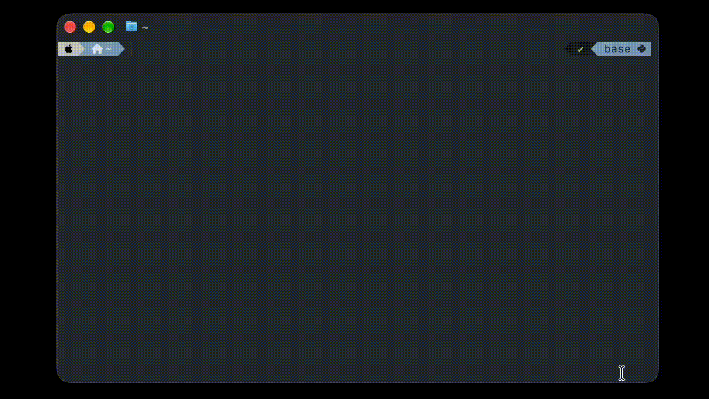

<p align="center">
  <picture>
    
  </picture>
</p>

<h1 align="center">DeckSempai</h1>

<p align="center">
    Assistant to the regional flashcard deck manager
</p>

## Features
* Import/export cards from/to Anki
* Automatically translate
* Automatically add pronunciation sounds
* Automatically add grammar help (articles, plurals, tenses, superlatives etc.)

<p align="center">
  <picture>
    
  </picture>
</p>

## Installation

DeckSempai is installed with [uv](https://docs.astral.sh/uv/), a Python package and project manager.

### 1. Install uv

macOS / Linux:

```bash
curl -LsSf https://astral.sh/uv/install.sh | sh
```

Windows (PowerShell):

```powershell
powershell -ExecutionPolicy ByPass -c "irm https://astral.sh/uv/install.ps1 | iex"
```

Or with Homebrew: `brew install uv`. See the [uv installation docs](https://docs.astral.sh/uv/getting-started/installation/) for other options.

### 2. Install DeckSempai

```bash
uv tool install git+https://github.com/lkyzlik/deck-sempai.git
```

Or from a local clone:

```bash
git clone https://github.com/lkyzlik/deck-sempai.git
cd deck-sempai
uv tool install .
```

uv will fetch a suitable Python (>=3.13) automatically if needed. The `sempai` command is then available on your `PATH`:

```bash
sempai --help
```

To upgrade later, run `uv tool upgrade deck-sempai`; to remove it, `uv tool uninstall deck-sempai`.

## License

DeckSempai is released under the [MIT License](LICENSE).


